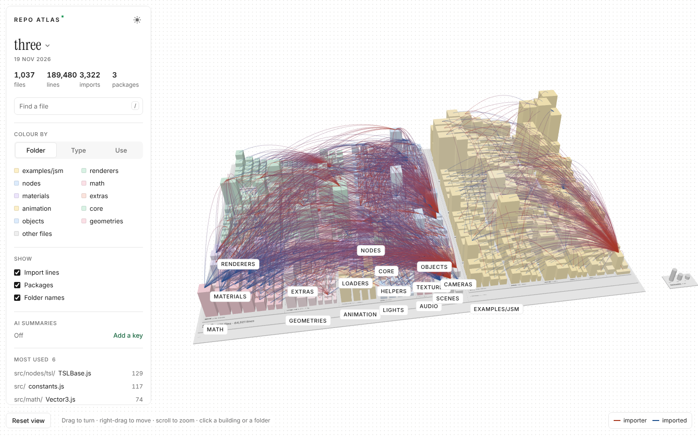

# repo atlas

A 3D map of a repo's architecture, laid out as a city. Point it at your code folder: it reads the files and their imports, and shows each project as a city you can turn, search and click. Everything runs on your computer.

- **Folders are districts**: raised plates, nested one level per folder. A folder holding only one folder is merged into it (`app/src`).
- **Files are buildings**: footprint and height grow with lines of code (non-blank lines; past 1,500 lines a building only grows a little, so a vendored file doesn't dwarf the city).
- **Imports are arcs**: from the importer (orange) to the imported file (blue).
- **Packages** (npm, `node`, Python modules, sibling repos reached with `../`) stand in their own district beside the city, as round towers sized by how many files use them.

<picture>
  <source media="(prefers-color-scheme: dark)" srcset="docs/screenshot-dark.png">
  
</picture>

## Use

```sh
npm install
npm start            # = node bin/atlas.mjs serve --open
```

`atlas serve [folder]` opens the map in your browser at http://localhost:4317 and lists the projects in `[folder]` (by default the folder repo-atlas sits in, such as `~/Code`), most recently changed first. Click the project's name at the top left (or press `p`) to switch: pick one, type a path, or, on a Mac, choose any folder in Finder. The server listens on this computer only.

To write one map as a file instead (to keep or share):

```sh
node bin/atlas.mjs ../learn-fm --open
```

Options:

| | |
|---|---|
| `--open` | open the browser |
| `--port <n>` | `serve`: the port (default 4317) |
| `--out <file>` | one map: where to write it (default `maps/<repo>.html`) |
| `--all` | also show data and docs files nothing imports (`.md`, `.json`, …) |
| `--ignore <dir>` | one map: leave a folder out (repeatable) |
| `--no-source` | leave the code out of the map (it's there for the optional AI summaries) |
| `--public` | one map: structure only, for a map anyone may see: no code, comments, doc quotes, exports or commit messages |
| `--back <url>` | one map: a link back at the top of the map, labelled with `--back-label` |
| `--json` | one map: write the scanned graph as JSON instead |

`ATLAS_DEBUG=1` prints every import that couldn't be resolved. `npm link` gives you an `atlas` command anywhere.

## In the map

- Like Studio G's office: scroll to move across the city, pinch (or Ctrl/⌘ + scroll) to zoom at the pointer, drag to turn. With a mouse, right-drag also moves. Arrow keys move, `+` and `-` zoom, `/` finds a file, `Esc` clears, `h` resets the view.
- **Click a building**: the camera frames it with everything it uses (blue) and everything that uses it (orange). The panel, top to bottom:
  - **Summary**: with your own AI key, a few sentences on what the file does and why it's there (see below).
  - **Connections** in words (and an import cycle, if it's in one), then **Uses** and **Is used by**.
  - **History** from git: created, last changed and why, how many commits, how many in the last 90 days, by how many people (renames followed). Large files that change often are flagged as hotspots.
  - **Exports** (functions, components, types) and **Packages**.
- **Role** comes from common conventions (page and its address, screen, API route, component, hook, test, migration, config, script…) and shows under the file's name.
- **Click a folder**: what it reaches out to and what reaches into it, grouped by folder, and its most-used files.
- **Colour by** folder (the main areas; when one folder holds most of the repo, like `src/`, its sub-folders are the areas), file type, or use (how many files import it).
- The left panel lists the most-used files, the largest, the ones that changed most in the last 90 days, and the import cycles.

## AI summaries (optional)

Add a Claude or OpenAI key from **AI summaries** in the left panel (or from a building's Summary). Then **Write a summary** asks the model, with the file's code, its opening comment, what the repo's docs say about it, and what it uses and what uses it. The key stays in your browser (localStorage); requests go from your browser straight to the provider, billed to your key. Summaries are kept in the browser per file and redone when the file changes.

For that, the map holds each file's code (up to 24,000 characters a file). Make a map with `--no-source` to leave the code out, for instance before sharing a map of a private repo.

## Design

Repo atlas uses Studio G's design system: its tokens (`src/viewer/tokens.css`, copied by hand from Studio G), Inter and Instrument Serif (embedded, SIL Open Font License), the dotted canvas, and two themes, Light and After hours, with the Eclipse switch. Its signature colour is mint. Folders and file types take the tag colours.

## What it reads

- **JS/TS** (`.ts .tsx .js .jsx .mjs .cjs`), **Astro, Vue, Svelte, MDX**: `import`, `export … from`, `import()`, `require()`. Relative paths, `.js` written for `.ts` files, `index` files, and `paths` aliases from the nearest `tsconfig.json`/`jsconfig.json` (so monorepos with one config per app work).
- **CSS/SCSS**: `@import`, `@use`.
- **Python**: `import` and `from … import`, relative or from the root or `src/`.
- **Go**: imports inside the module (`go.mod`).
- Other code files (`.sql`, `.sh`, `.rs`, …) appear as buildings without links.

Files come from `git ls-files` (tracked and untracked, `.gitignore` respected), or a folder walk when it isn't a git repo. Generated and vendored folders are skipped (`node_modules`, `dist`, `build`, `.next`, `ios`, `android`, …).

Imports are found with patterns, not a compiler, so very dynamic imports (built strings, framework file-system routes) don't show as arcs.

## Layout of this repo

- `bin/atlas.mjs`: the command. `src/serve.mjs` is the local server with the project picker, `src/render.mjs` turns data into the page.
- `src/scan.mjs`: files, lines, imports and their resolution.
- `src/describe.mjs`: what a file is for: opening comment, doc mentions, role, exports.
- `src/history.mjs`: each file's git history, from one `git log` over the repo.
- `src/viewer/`: the page. `main.js` only wires the parts together:
  - the data: `city.js` lays out the city (squarified treemap), `graph.js` finds who uses whom and the cycles;
  - the 3D: `scene.js` (renderer, camera, lights), `city3d.js` (plates, buildings, packages, painted names), `lines.js` (import arcs), `paint.js` (colours for the current selection), `colours.js` (colours from the tokens), `navigation.js` (scroll, pinch, drag, flights), `pointer.js` (hover and click);
  - the panels: `sidebar.js` (left), `panel.js` (right), `lists.js`, `summary.js` with `ai.js` (the optional summaries), `picker.js` (the project picker), `util.js`.
  - `tokens.css` and `fonts/` come from Studio G.
- `scripts/build.mjs`: bundles the viewer with three.js into `dist/viewer.js` (esbuild); `atlas` rebuilds it when the viewer's sources change.

## License

MIT for the code. The fonts in `src/viewer/fonts` are under the SIL Open Font License 1.1. Made by [Studio G](https://studiog.build).
